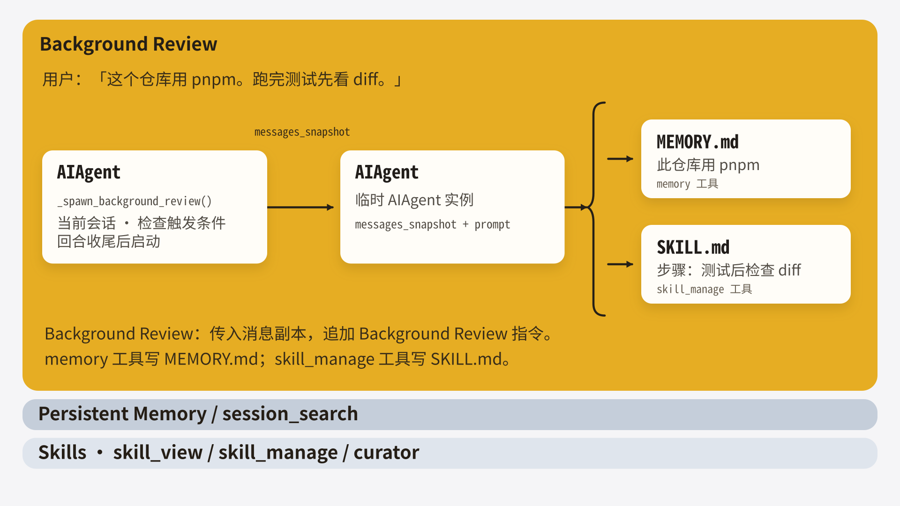
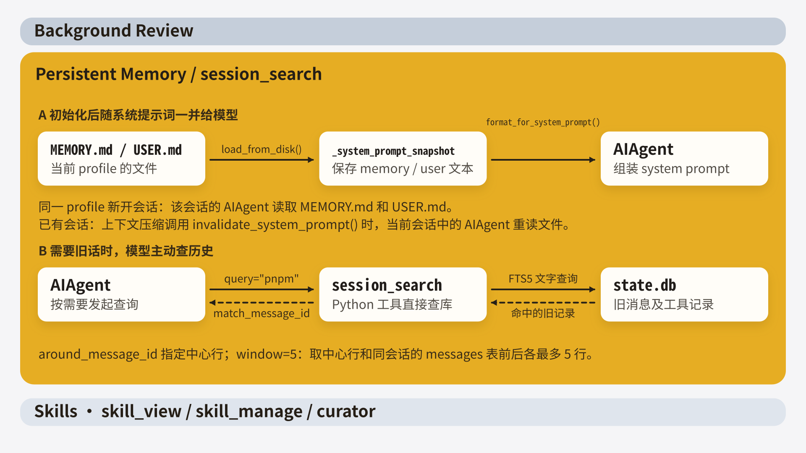
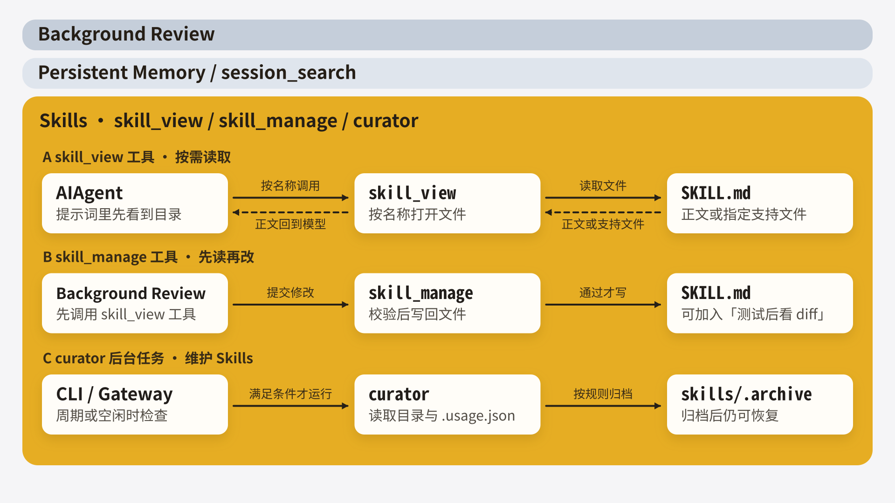
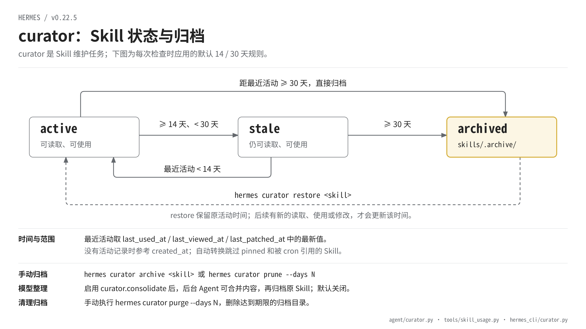

# Hermes Agent：记忆、Skill 与跨会话演进

## TL;DR：Hermes 的 10 个记忆问题

**关键区别：** `memory` 工具修改 `MEMORY.md` 和 `USER.md`，`session_search` 工具查找历史消息，Skill 保存可复用的做法。下面以 Hermes Agent v0.22.5 的源码为准。

1. **何时触发？** 当前会话的模型可主动调用 `memory` 或 `skill_manage` 工具；Background Review 默认每 10 个用户轮检查记忆、每 10 次准备模型请求检查 Skill。
2. **谁来处理？** 当前会话中的 Agent 可直接写；后台另建临时 `AIAgent`，相同文字只追加一次。
3. **看哪些消息？** 默认用当前会话仍保留的消息；为后台另选服务商或模型后，才摘要较早的消息。
4. **什么值得存？** `USER.md` 记用户信息，`MEMORY.md` 记环境与项目约定，Skill 记可复用做法。
5. **Prompt 怎么写？** 记忆 Prompt 指定保存位置；Skill Prompt 要求提炼技巧和纠正。
6. **文件怎么组织？** `MEMORY.md` 和 `USER.md` 遇到独占一行的 `§` 就分开，每段算一个 `entry`；Skill 以 `SKILL.md` 为入口。
7. **怎么更新？** `memory` 工具用 `action="patch"` 改文字；`skill_manage` 工具改 Skill。
8. **什么时候审批？** 后台改删记忆先让用户批准；Skill 由 `skills.write_approval` 控制。
9. **谁共享？** 同一 profile 共用记忆文件；Skill 还可从受信任项目目录读取。
10. **何时读到？** 新开会话时，新的 `AIAgent` 读取文件；已有会话在调用 `invalidate_system_prompt()` 时重读。

## 1. Background Review 与 `memory` 工具

### `memory` 工具：模型怎样改 `MEMORY.md` 或 `USER.md`

`memory` 工具用 `target` 选要修改的文件，一次调用只改一个。[`memory` 工具的注册与参数入口](https://github.com/NousResearch/hermes-agent/blob/bf0203a794a07aac3ff764972ab9087baa4e4f4e/tools/memory_tool.py#L474-L485) · [target 对应的文件](https://github.com/NousResearch/hermes-agent/blob/bf0203a794a07aac3ff764972ab9087baa4e4f4e/tools/memory_tool_store.py#L298-L301)

- `target="memory"`：`MEMORY.md`。

- `target="user"`：`USER.md`。

**当前会话何时保存**

- 「以后默认用 TypeScript」：当前会话中的 Agent 可以当场写进 `USER.md`。

- 「这次用 TypeScript」：只约束当前任务。

**当前会话怎样主动保存 Memory**

- **不必等用户说“记住”。** 当前会话的模型可以依据 system prompt 和 `memory` 工具说明，判断遇到的事实是否值得保存，再调用工具。例如用户介绍自己的长期职责，模型可将事实写入 `USER.md`；是否调用由模型判断，写入仍遵循审批设置。[`memory` 工具的 WHEN / SKIP](https://github.com/NousResearch/hermes-agent/blob/bf0203a794a07aac3ff764972ab9087baa4e4f4e/tools/memory_tool.py#L375-L398)
- **提示从哪里来？** `_tool_guidance_block()` 在 `memory` 工具可用时调用 `build_memory_guidance()`，生成与已启用文件对应的提示；两种内置存储都关闭时返回空字符串，只启用用户资料时只引导写 `target="user"`。这段指导经 `_guidance_parts()` 放进 system prompt 的 `stable` 部分。[工具与开关条件](https://github.com/NousResearch/hermes-agent/blob/bf0203a794a07aac3ff764972ab9087baa4e4f4e/agent/system_prompt.py#L274-L299) · [按存储生成指导](https://github.com/NousResearch/hermes-agent/blob/bf0203a794a07aac3ff764972ab9087baa4e4f4e/agent/prompt_builder.py#L192-L230) · [组装到 stable](https://github.com/NousResearch/hermes-agent/blob/bf0203a794a07aac3ff764972ab9087baa4e4f4e/agent/system_prompt.py#L748-L754)
- **什么适合主动记？** `build_memory_guidance()` 把具体任务的方法、踩坑，以及用户对这类任务的偏好和纠正优先交给 Skill；Memory 保存跨任务仍适用的用户事实、稳定环境事实和长期约定。写成事实陈述，例如“用户偏好简短回答”，而不是给未来模型下命令。预计一周内就会过时的事实留在会话历史。[Memory 与 Skill 的分工](https://github.com/NousResearch/hermes-agent/blob/bf0203a794a07aac3ff764972ab9087baa4e4f4e/agent/prompt_builder.py#L208-L230)

**空闲、关闭会话时发生什么**

内置 Memory 的 Background Review 在回合收尾检查计数和完成条件。使用本地模型的延后队列时，空闲后执行的是此前已经排队的任务；队列为空就没有任务可取。单纯停止发消息或关闭会话，不会凭这个动作新建一次默认 Background Review。[回合收尾条件](https://github.com/NousResearch/hermes-agent/blob/bf0203a794a07aac3ff764972ab9087baa4e4f4e/agent/turn_finalizer.py#L778-L795) · [只取已排队任务](https://github.com/NousResearch/hermes-agent/blob/bf0203a794a07aac3ff764972ab9087baa4e4f4e/agent/review_idle_queue.py#L126-L142)

配置了外部 memory provider 时，还有单独的生命周期：完成且未中断的回合可通过 `sync_all()` 同步；真正结束会话时，`shutdown_memory_provider()` 调用 `on_session_end(messages)`；切换会话 ID 时，`commit_memory_session()` 也可调用这个接口。具体是否抽取、保存什么由 provider 实现决定。[回合同步](https://github.com/NousResearch/hermes-agent/blob/bf0203a794a07aac3ff764972ab9087baa4e4f4e/run_agent.py#L904-L921) · [会话结束与切换](https://github.com/NousResearch/hermes-agent/blob/bf0203a794a07aac3ff764972ab9087baa4e4f4e/run_agent.py#L871-L890) · [provider 接口](https://github.com/NousResearch/hermes-agent/blob/bf0203a794a07aac3ff764972ab9087baa4e4f4e/agent/memory_provider.py#L183-L184)

**Background Review 的自动触发条件。** 默认累计 **10 个用户轮**检查记忆，或累计 **10 次准备模型请求**检查 Skill。任一计数达标后，程序等当前回合生成最终答复；回合未中断、自动检查也未被禁用，才安排后台任务。本轮是否已写过记忆不参与这个判断。[记忆计数](https://github.com/NousResearch/hermes-agent/blob/bf0203a794a07aac3ff764972ab9087baa4e4f4e/agent/turn_context.py#L758-L767) · [收尾时检查 Skill 计数并调度](https://github.com/NousResearch/hermes-agent/blob/bf0203a794a07aac3ff764972ab9087baa4e4f4e/agent/turn_finalizer.py#L763-L792)

**`memory` 工具参数** 用 `memory` 工具的 `action="add"` 新增 `entry`，把要保存的文字传给 `content`。下面是模型要记录「这个仓库用 pnpm」时发出的工具参数示例。[action / target / content 定义](https://github.com/NousResearch/hermes-agent/blob/bf0203a794a07aac3ff764972ab9087baa4e4f4e/tools/memory_tool.py#L399-L418)

[工具参数示例（GitHub JSON 文件）](https://github.com/pixelieee/pixelieee.github.io/blob/main/hermes-memory-add.json)

**相同文字的处理。** `MemoryStore.add()` 去掉 `content` 首尾空白，再比对目标文件里的 `entries`。已有「用 pnpm 装依赖」就跳过这段完全相同的文字；「安装依赖用 pnpm」会按新 `entry` 处理。[源码](https://github.com/NousResearch/hermes-agent/blob/bf0203a794a07aac3ff764972ab9087baa4e4f4e/tools/memory_tool_store.py#L369-L388)

**`memory` 工具的更新操作**

- **改一段：** `action="patch"` 用 `old_text` 找原文，用 `content` 替换。比如把「这个仓库用 npm；改动后先跑测试」里的前半句换成 pnpm，测试要求保留。

- **删整段：** `action="remove"` 用 `old_text` 找到并删除整个 `entry`。匹配到多个不同的 `entries` 时返回 `ambiguous`。[patch、remove 与匹配失败](https://github.com/NousResearch/hermes-agent/blob/bf0203a794a07aac3ff764972ab9087baa4e4f4e/tools/memory_tool_store.py#L419-L461) · [拒绝 replace](https://github.com/NousResearch/hermes-agent/blob/bf0203a794a07aac3ff764972ab9087baa4e4f4e/tools/memory_tool.py#L275-L289)

[工具参数示例（GitHub JSON 文件）](https://github.com/pixelieee/pixelieee.github.io/blob/main/hermes-memory-patch.json)

**`MemoryStore._mutate()` 怎样写文件**

- 加锁后重读目标文件，再检查文本匹配和字符数。[加锁、重读、写入](https://github.com/NousResearch/hermes-agent/blob/bf0203a794a07aac3ff764972ab9087baa4e4f4e/tools/memory_tool_store.py#L338-L367)

- 用 `operations` 可把多项改动放在一起，按修改后的总长度检查。例如先删旧 `entry` 再新增，整组通过才更新目标文件。[operations 参数](https://github.com/NousResearch/hermes-agent/blob/bf0203a794a07aac3ff764972ab9087baa4e4f4e/tools/memory_tool.py#L424-L445)

- 程序先写临时文件，再用它替换原文件。[原子写入](https://github.com/NousResearch/hermes-agent/blob/bf0203a794a07aac3ff764972ab9087baa4e4f4e/tools/memory_tool_store.py#L675-L683)

**`memory` 工具返回什么**

- **已更新：** 返回 `success`、`done`、`target`、`usage` 和 `entry_count`。用 `action="patch"` 时还返回 `patched_entry_before`、`patched_entry_after`。[成功返回字段](https://github.com/NousResearch/hermes-agent/blob/bf0203a794a07aac3ff764972ab9087baa4e4f4e/tools/memory_tool_store.py#L623-L636)

- **待审批：** 后台 Agent 提交 `action="patch"` 或 `action="remove"` 时，工具返回 `staged: true` 和 `pending_id`。用户批准后，Hermes 核对原 `entry` 再修改。[后台审批返回字段](https://github.com/NousResearch/hermes-agent/blob/bf0203a794a07aac3ff764972ab9087baa4e4f4e/tools/memory_tool.py#L179-L219)

**批准命令**

- **记忆：** `/memory pending` 查看，`/memory approve <id>` 应用。开启 `memory.write_approval` 后，新增也要批准。[记忆审批](https://github.com/NousResearch/hermes-agent/blob/bf0203a794a07aac3ff764972ab9087baa4e4f4e/website/docs/user-guide/features/memory.md#L329-L362)

- **Skill：** `skill_manage` 工具默认校验通过后直接写。开启 `skills.write_approval` 后，用 `/skills diff <id>` 查看差异、`/skills approve <id>` 应用。[Skill 审批](https://github.com/NousResearch/hermes-agent/blob/bf0203a794a07aac3ff764972ab9087baa4e4f4e/website/docs/user-guide/features/memory.md#L516-L541)

这条工具结果只回给调用它的模型。写好文件不会立即刷新当前会话的 system prompt；下一节说明何时重读。要查用户上次原话或那次命令输出，用 `session_search` 工具查 `state.db`。[Session Search](https://github.com/NousResearch/hermes-agent/blob/bf0203a794a07aac3ff764972ab9087baa4e4f4e/website/docs/user-guide/features/memory.md#session-search)

**[Background Review](https://github.com/NousResearch/hermes-agent/blob/bf0203a794a07aac3ff764972ab9087baa4e4f4e/website/docs/user-guide/features/memory.md#background-review-notifications-displaymemory_notifications) 用两套计数**

- **记忆：** `memory.nudge_interval` 默认 10 个用户轮。每来一条新用户消息，若计数启用且 `memory` 工具和存储可用，`_tick_memory_nudge()` 把 `_turns_since_memory` 加 1。[记忆计数源码](https://github.com/NousResearch/hermes-agent/blob/bf0203a794a07aac3ff764972ab9087baa4e4f4e/agent/turn_context.py#L758-L767)

- **Skill：** `prepare_iteration()` 每准备一次模型请求，若计数启用且 `skill_manage` 工具可用，`_iters_since_skill` 加 1。这个步骤可调用多个工具，也可以不调工具。[Skill 计数源码](https://github.com/NousResearch/hermes-agent/blob/bf0203a794a07aac3ff764972ab9087baa4e4f4e/agent/turn_iteration_prep.py#L144-L167)

**记忆：用户轮计数加 1，到阈值时返回 `True`。**

[GitHub 源码：用户轮计数](https://github.com/NousResearch/hermes-agent/blob/bf0203a794a07aac3ff764972ab9087baa4e4f4e/agent/turn_context.py#L758-L767)

**Skill：准备一次模型请求，内部步骤计数加 1。** 此处只加计数，收尾时才检查阈值。

[GitHub 源码：模型步骤计数](https://github.com/NousResearch/hermes-agent/blob/bf0203a794a07aac3ff764972ab9087baa4e4f4e/agent/turn_iteration_prep.py#L144-L167)

**例如，你只说了一次「修好测试」。** 模型先让 Agent 读两个文件，算 1 步；拿到文件内容后，模型决定运行测试，再算 1 步；看到测试结果后，模型直接给最终答复，即使没调工具也算 1 步。这次是 **1 个用户轮、3 个 Agent 内部步骤**。

**程序在回合收尾时安排 Background Review**

- **计数：** `skills.creation_nudge_interval` 默认 10 个内部步骤。假设已有 8 步，本轮第 2 步到阈值，Agent 仍先做完第 3 步。[默认值源码](https://github.com/NousResearch/hermes-agent/blob/bf0203a794a07aac3ff764972ab9087baa4e4f4e/agent/agent_init.py#L1386-L1390)

- **收尾条件：** 有最终答复、回合未中断、宿主未跳过。记忆和 Skill 同时到阈值时，合成一次 Background Review。[收尾检查源码](https://github.com/NousResearch/hermes-agent/blob/bf0203a794a07aac3ff764972ab9087baa4e4f4e/agent/turn_finalizer.py#L763-L792)

- **开关：** `auxiliary.background_review.enabled` 控制自动启动。程序在收尾时检查，无需等待聊天平台确认送达。[调度源码](https://github.com/NousResearch/hermes-agent/blob/bf0203a794a07aac3ff764972ab9087baa4e4f4e/run_agent.py#L757-L787)

### Background Review 怎样启动

**消息副本和后台线程**

- **复制：** 回合收尾调用 `_spawn_background_review()`；`_clone_background_review_messages()` 复制消息，也复制内层的工具调用和内容。[收尾传入 messages](https://github.com/NousResearch/hermes-agent/blob/bf0203a794a07aac3ff764972ab9087baa4e4f4e/agent/turn_finalizer.py#L782-L792) · [复制与调度](https://github.com/NousResearch/hermes-agent/blob/bf0203a794a07aac3ff764972ab9087baa4e4f4e/run_agent.py#L775-L787)

- **排队：** `auxiliary.background_review.defer: auto` 且使用 Hermes 托管的本地 `llama-server` 时，任务等所在进程没有正在处理的聊天回合、且本地模型空闲。等到 `defer_max_age_s`（默认 30 分钟）也可被取出。[队列等待与超时](https://github.com/NousResearch/hermes-agent/blob/bf0203a794a07aac3ff764972ab9087baa4e4f4e/agent/review_idle_queue.py#L24-L42) · [取出条件](https://github.com/NousResearch/hermes-agent/blob/bf0203a794a07aac3ff764972ab9087baa4e4f4e/agent/review_idle_queue.py#L126-L142)

- **执行：** `bg-review` 后台线程运行任务。[启动后台线程](https://github.com/NousResearch/hermes-agent/blob/bf0203a794a07aac3ff764972ab9087baa4e4f4e/run_agent.py#L813-L824)

[GitHub 源码：复制消息与安排后台任务](https://github.com/NousResearch/hermes-agent/blob/bf0203a794a07aac3ff764972ab9087baa4e4f4e/run_agent.py#L775-L787)

**`build_cache_parity_fork()` 在线程里新建一个临时 `AIAgent`。** 它沿用当前会话的 `session_id`，关闭自身的会话持久化，也不接会话数据库。用户的会话列表里仍是原对话；这个 `AIAgent` 实例只运行一次后台任务。它可以通过 `memory` 工具和 `skill_manage` 工具提交修改，哪些改动要等批准见第 8 问。[实例创建与持久化隔离](https://github.com/NousResearch/hermes-agent/blob/bf0203a794a07aac3ff764972ab9087baa4e4f4e/agent/background_review.py#L986-L1005)

[GitHub 源码：临时 AIAgent 与持久化隔离](https://github.com/NousResearch/hermes-agent/blob/bf0203a794a07aac3ff764972ab9087baa4e4f4e/agent/background_review.py#L986-L1005)

### Background Review 读取哪些历史消息

**默认没有固定条数。** `messages_snapshot` 是当前会话回合收尾时仍保留的消息副本，里面有多少条就交多少条，包含仍保留的工具调用和结果。已经被压缩掉的原消息不会从数据库补读。

- **默认用当前会话的服务商和模型（`_routed=False`）。** Hermes 把整份 `messages_snapshot` 交给 `conversation_history`，沿用当前会话请求的缓存前缀。

- **也可以为 Background Review 单独指定服务商和模型。** 在 `auxiliary.background_review` 下填 `provider` 和 `model`，例如[官方配置示例](https://github.com/NousResearch/hermes-agent/blob/bf0203a794a07aac3ff764972ab9087baa4e4f4e/website/docs/user-guide/features/memory.md#L394-L417)里的 `provider: openrouter` 和 `model: google/gemini-3-flash-preview`。两项的组合和当前会话所用的不同、且配置能解析时，`_routed=True`。这次请求不能沿用当前会话的模型缓存，Hermes 就用 `_digest_history()` 减少重新发送的内容：从最近 24 条消息开始保留原文，把更早的消息拼成一条摘要。未填写、选了同一组，或配置解析失败，都用当前会话的服务商和模型。[选择后台模型的代码](https://github.com/NousResearch/hermes-agent/blob/bf0203a794a07aac3ff764972ab9087baa4e4f4e/agent/background_review.py#L269-L291)

两种分支都另外传一条 Background Review 指令 `user_message`。**24 指 Background Review 切换服务商或模型后，开始保留近期原消息的条数。** [分支与两个入参](https://github.com/NousResearch/hermes-agent/blob/bf0203a794a07aac3ff764972ab9087baa4e4f4e/agent/background_review.py#L1184-L1193)

[GitHub 源码：run_conversation 的两个入参](https://github.com/NousResearch/hermes-agent/blob/bf0203a794a07aac3ff764972ab9087baa4e4f4e/agent/background_review.py#L1184-L1193)

**切换到单独配置的服务商或模型后，`_digest_history()` 怎么处理历史？** 默认从末尾取 24 条，工具结果也算一条。保留区间不能以 `role="tool"` 开头，所以切口遇到工具结果就向前移；总数不超过 24 条则原样保留。前面被折叠的消息由 Python 拼成一条 `role="user"` 摘要：每条旧用户文字最多 300 字符，每条旧助手文字最多 200 字符；旧工具只留名称，不留参数和输出。[窗口和拼接源码](https://github.com/NousResearch/hermes-agent/blob/bf0203a794a07aac3ff764972ab9087baa4e4f4e/agent/background_review.py#L332-L362)

[GitHub 源码：保留近期消息的边界](https://github.com/NousResearch/hermes-agent/blob/bf0203a794a07aac3ff764972ab9087baa4e4f4e/agent/background_review.py#L332-L362)

### Background Review 默认可调用的工具

**后台执行名单**

- **默认工具：** `skills_list` 工具列目录，`skill_view` 工具读正文，`skill_manage` 工具提交 Skill 变更；`read_file` 工具读文件，`search_files` 工具查找文件。[skills 工具集定义](https://github.com/NousResearch/hermes-agent/blob/bf0203a794a07aac3ff764972ab9087baa4e4f4e/toolsets.py#L103-L107)

- **什么时候加入 `memory` 工具：** `review_memory=True`，且启用了 `MEMORY.md` 或 `USER.md` 对应的记忆功能。只达到 Skill 阈值时，后台 Agent 默认使用 `skill_manage` 工具更新 Skill。[memory 工具集定义](https://github.com/NousResearch/hermes-agent/blob/bf0203a794a07aac3ff764972ab9087baa4e4f4e/toolsets.py#L127-L129) · [实际白名单条件](https://github.com/NousResearch/hermes-agent/blob/bf0203a794a07aac3ff764972ab9087baa4e4f4e/agent/background_review.py#L1088-L1103)

[GitHub 源码：后台工具白名单](https://github.com/NousResearch/hermes-agent/blob/bf0203a794a07aac3ff764972ab9087baa4e4f4e/agent/background_review.py#L1088-L1103)

**工具定义与执行权限**

- **模型请求：** 沿用当前会话的模型时，后台复制该会话的工具定义，以复用提示词缓存。[复制当前会话的工具定义](https://github.com/NousResearch/hermes-agent/blob/bf0203a794a07aac3ff764972ab9087baa4e4f4e/agent/background_review.py#L954-L961)

- **实际执行：** 后台按自己的名单放行工具。默认会拒绝 `terminal`、`write_file` 和 `patch`；`auxiliary.background_review.extra_tools` 只能追加已有的工具。[额外工具配置](https://github.com/NousResearch/hermes-agent/blob/bf0203a794a07aac3ff764972ab9087baa4e4f4e/agent/background_review.py#L1116-L1128)

- **后台修改记忆：** `memory` 工具收到 `action="patch"` 或 `action="remove"` 后，先交给用户审批。[写入校验](https://github.com/NousResearch/hermes-agent/blob/bf0203a794a07aac3ff764972ab9087baa4e4f4e/tools/memory_tool.py)

**Background Review 的提示词。** `_MEMORY_REVIEW_PROMPT` 按 `_MEMORY_ROUTING_BLOCK` 引导模型选文件：`USER.md` 写 *who the user is*，`MEMORY.md` 写 *facts about the ENVIRONMENT you operate in*。`_SKILL_REVIEW_PROMPT` 则检查能复用的技巧和纠正。比如用户多次退回 JavaScript 实现并给出 TypeScript 版本，模型可以把这归纳为这类任务的做法，写进对应 Skill。没有值得保存的经验时，可以输出 `Nothing to save.`。[文件分工](https://github.com/NousResearch/hermes-agent/blob/bf0203a794a07aac3ff764972ab9087baa4e4f4e/agent/background_review.py#L370-L388) · [Skill 取材与写入顺序](https://github.com/NousResearch/hermes-agent/blob/bf0203a794a07aac3ff764972ab9087baa4e4f4e/agent/background_review.py#L448-L518)

## 2. Persistent Memory 与 Session Search

**`load_from_disk()` 读取记忆文件**

- 当前会话的 `AIAgent` 初始化时，会读取完整的记忆文件。Hermes 读取 `MEMORY.md` 或 `USER.md`，遇到独占一行的 `§` 就分开。分出来的每一段，算一个 `entry`。[读取文件与分段](https://github.com/NousResearch/hermes-agent/blob/bf0203a794a07aac3ff764972ab9087baa4e4f4e/tools/memory_tool_store.py#L647-L673)

例如，「这个仓库用 pnpm」和「提交前跑测试」之间放一行 `§`，读出来就是两个 `entry`。一段可以有多行，普通换行不会另算。

- 程序去掉首尾空白、跳过空内容，并保留相同 `entry` 的第一次。安全扫描命中的 `entry` 在 system prompt 中显示为 `[BLOCKED: …]`，文件原文保留。[去重、扫描](https://github.com/NousResearch/hermes-agent/blob/bf0203a794a07aac3ff764972ab9087baa4e4f4e/tools/memory_tool_store.py#L221-L253)

**`_render_block()` 生成记忆段**

- **正文和标题：** 用 `§` 拼接处理后的 `entries`，再加标题与字符用量。`MEMORY.md` 对应 `MEMORY (your personal notes)`，`USER.md` 对应 `USER PROFILE (who the user is)`。[标题常量](https://github.com/NousResearch/hermes-agent/blob/bf0203a794a07aac3ff764972ab9087baa4e4f4e/tools/memory_tool_store.py#L22-L25) · [生成提示词段落](https://github.com/NousResearch/hermes-agent/blob/bf0203a794a07aac3ff764972ab9087baa4e4f4e/tools/memory_tool_store.py#L638-L644)

- **例子：** 「这个仓库用 pnpm」和「提交前跑测试」若都通过检查，system prompt 中就保留这两句。文件为空则省略这一段。

- **字数：** 写入默认上限为 `MEMORY.md` 2200 字符、`USER.md` 1375 字符。手工将文件写超限时，加载会告警，并继续处理文件里的 `entries`。

[GitHub 源码：生成记忆段](https://github.com/NousResearch/hermes-agent/blob/bf0203a794a07aac3ff764972ab9087baa4e4f4e/tools/memory_tool_store.py#L638-L644)

这两段生成好的文字才存进 `_system_prompt_snapshot["memory"]` 和 `_system_prompt_snapshot["user"]`。这两个字段保存内置 Markdown 文件生成的记忆段。设置 `memory.provider` 后，`_memory_parts()` 还可以追加外部记忆服务返回的文字。[内置文件与外部 provider 的拼接](https://github.com/NousResearch/hermes-agent/blob/bf0203a794a07aac3ff764972ab9087baa4e4f4e/agent/system_prompt.py#L522-L547)

`format_for_system_prompt()` **只是从这两段里取出所需的那段文字**；`_memory_parts()` 再把启用且非空的段落交给系统提示词组装。同一份系统提示词还包含身份、运行指引、项目指令、Skill 目录等其他部分。`_system_prompt_snapshot` 只存记忆文字，不存整份系统提示词。[取记忆文字](https://github.com/NousResearch/hermes-agent/blob/bf0203a794a07aac3ff764972ab9087baa4e4f4e/tools/memory_tool_store.py#L618-L621) · [把记忆拼入系统提示词](https://github.com/NousResearch/hermes-agent/blob/bf0203a794a07aac3ff764972ab9087baa4e4f4e/agent/system_prompt.py#L736-L799)

[GitHub 源码：系统提示词的组成](https://github.com/NousResearch/hermes-agent/blob/bf0203a794a07aac3ff764972ab9087baa4e4f4e/agent/system_prompt.py#L736-L799)

**例子：从 npm 改成 pnpm。** 当前会话中的 `AIAgent` 启动时，文件里写的是「用 npm」，所以系统提示词里的记忆段也是这句话。后来 Background Review 的后台 Agent 调用 `memory` 工具，把 `MEMORY.md` 改成「用 pnpm」。`MEMORY.md` 已经更新，但这次工具返回的结果只进后台的对话，不会追加到当前会话；当前会话 system prompt 里的记忆段因此仍可能是 npm。

**当前会话何时看到 pnpm**

- **工具结果：** 当前会话中的 Agent 调用 `memory` 工具时，该会话的模型马上收到工具返回的信息。

- **system prompt：** 同一 profile 新开会话时，新的 `AIAgent` 读取文件；已有会话在上下文压缩调用 `invalidate_system_prompt()` 时，由该会话的 `AIAgent` 调用 `load_from_disk()`，再重新组装后续请求。[memory 工具](https://github.com/NousResearch/hermes-agent/blob/bf0203a794a07aac3ff764972ab9087baa4e4f4e/tools/memory_tool.py) · [压缩后的重读入口](https://github.com/NousResearch/hermes-agent/blob/bf0203a794a07aac3ff764972ab9087baa4e4f4e/agent/system_prompt.py#L814-L832)

[GitHub 源码：读取已生成的记忆文字](https://github.com/NousResearch/hermes-agent/blob/bf0203a794a07aac3ff764972ab9087baa4e4f4e/tools/memory_tool_store.py#L618-L621)

**先搜一句。** 调用 `session_search` 工具并传 `query="pnpm"`，它用 [SQLite FTS5](https://sqlite.org/fts5.html) 搜数据库中的文字。FTS5 是 SQLite 自带的全文索引扩展；这里用它匹配消息文本，不需要把消息转成向量，也不另叫模型写摘要。默认只搜索 `user` / `assistant`，显式传 `role_filter="tool"` 才按工具结果去搜。搜索返回 `session_id`、`match_message_id` 和命中片段。[搜索结果和默认角色](https://github.com/NousResearch/hermes-agent/blob/bf0203a794a07aac3ff764972ab9087baa4e4f4e/tools/session_search_tool.py#L330-L385)

**再看命中前后：`window=5` 数的是 `messages` 表的行。** 例如你只发了一条「找出 pnpm 版本」，库里可以有四行：① `user` 提问；② `assistant` 发出工具调用；③ `tool` 返回版本；④ `assistant` 给最终答复。这是 **一个用户轮、四条消息**。如果一次助手消息发出两个工具调用，助手那条仍算一行，两个工具返回分别占行。[messages 表：role、tool_calls、tool_call_id](https://github.com/NousResearch/hermes-agent/blob/bf0203a794a07aac3ff764972ab9087baa4e4f4e/hermes_state_common.py#L531-L538)

**`session_search` 工具的两种读取方式**

- **围绕命中行（`scroll`）：** 传 `session_id` 和 `around_message_id=match_message_id`。默认 `window=5`，取中心行、同会话前后各最多 5 行，最多 11 行。按数据库行顺序读取，可以带回工具结果。[window 参数说明](https://github.com/NousResearch/hermes-agent/blob/bf0203a794a07aac3ff764972ab9087baa4e4f4e/tools/session_search_tool.py#L755-L769) · [按 id 取中心及前后行的 SQL](https://github.com/NousResearch/hermes-agent/blob/bf0203a794a07aac3ff764972ab9087baa4e4f4e/hermes_state_messages.py#L1407-L1424)

- **查看会话（`read`）：** 只传 `session_id`。会话超过 30 条消息时，默认返回最早 20 条和最近 10 条消息。[read 的截断](https://github.com/NousResearch/hermes-agent/blob/bf0203a794a07aac3ff764972ab9087baa4e4f4e/tools/session_search_tool.py#L447-L462)

[GitHub 源码：搜索角色与返回字段](https://github.com/NousResearch/hermes-agent/blob/bf0203a794a07aac3ff764972ab9087baa4e4f4e/tools/session_search_tool.py#L330-L385)

## 3. Skills：读取、修改和维护

**`curator` 是 Hermes 的 Skill 库维护任务。** 它读取 Skill 的使用记录，把受管理且长期未用的 Skill 标为 `stale`，符合归档条件时移入 `skills/.archive/`，之后可以恢复。[任务定义](https://github.com/NousResearch/hermes-agent/blob/bf0203a794a07aac3ff764972ab9087baa4e4f4e/agent/curator.py#L1-L7) · [状态更新与归档](https://github.com/NousResearch/hermes-agent/blob/bf0203a794a07aac3ff764972ab9087baa4e4f4e/agent/curator.py#L209-L260)

**Skill 是什么？** Hermes 官方叫 [Skills System](https://github.com/NousResearch/hermes-agent/blob/bf0203a794a07aac3ff764972ab9087baa4e4f4e/website/docs/user-guide/features/skills.md#skills-system)。一个 Skill 以 `SKILL.md` 为入口，写明特定任务可以怎么做，可附脚本、模板或参考资料。这里的例子就是：在验证 Skill 的 `Procedure` 里加一步「跑完测试先看 diff」。[SKILL.md 格式与 Procedure 示例](https://github.com/NousResearch/hermes-agent/blob/bf0203a794a07aac3ff764972ab9087baa4e4f4e/website/docs/user-guide/features/skills.md#skillmd-format)

**Skill 的发现、读取和修改**

- **发现：** `SKILL.md` 文件头有 `name` 和 `description`。系统提示词目录列 `load_name` 和 `description`；前者是传给 `skill_view` 工具的 `name` 参数。标成 `[names only]` 的类别省去 `description`。[目录组装时取的字段](https://github.com/NousResearch/hermes-agent/blob/bf0203a794a07aac3ff764972ab9087baa4e4f4e/agent/prompt_builder.py#L1309-L1317) · [names only 的渲染](https://github.com/NousResearch/hermes-agent/blob/bf0203a794a07aac3ff764972ab9087baa4e4f4e/agent/prompt_builder.py#L1342-L1354) · [目录生成](https://github.com/NousResearch/hermes-agent/blob/bf0203a794a07aac3ff764972ab9087baa4e4f4e/agent/prompt_builder.py#L1320-L1372)

- **读取：** 用 `skill_view` 工具读正文；传 `file_path` 可读支持文件。[正文与支持文件](https://github.com/NousResearch/hermes-agent/blob/bf0203a794a07aac3ff764972ab9087baa4e4f4e/tools/skills_tool.py#L580-L663)

- **修改：** Background Review 先用 `skill_view` 工具读取已有目标，再用 `skill_manage` 工具提交修改。[后台权限](https://github.com/NousResearch/hermes-agent/blob/bf0203a794a07aac3ff764972ab9087baa4e4f4e/agent/background_review.py#L365-L559)

**当前会话何时主动写 Skill**

- **新建：** `skill_manage` 工具可用时，系统提示词会加入 `SKILLS_GUIDANCE`。模型整理出可复用的复杂流程时，可以在当前回合调用 `skill_manage` 工具保存，无需用户发起，也无需等 Background Review 的计数达标。复杂或反复试错的任务结束时，`## Skills` 也提示模型可以提议保存成 Skill。[系统提示词注入](https://github.com/NousResearch/hermes-agent/blob/bf0203a794a07aac3ff764972ab9087baa4e4f4e/agent/system_prompt.py#L274-L297) · [`SKILLS_GUIDANCE` 原文](https://github.com/NousResearch/hermes-agent/blob/bf0203a794a07aac3ff764972ab9087baa4e4f4e/agent/prompt_builder.py#L257-L264)
- **更新：** 当前会话通过 `skill_view` 工具加载的 Skill 如果漏了步骤、命令有误，或需要补充新发现的注意事项，`## Skills` 指示模型在回复前调用 `skill_manage` 工具修订。是否调用由当前会话的模型判断，写入仍遵循 `skills.write_approval`。[系统提示词里的 `## Skills`](https://github.com/NousResearch/hermes-agent/blob/bf0203a794a07aac3ff764972ab9087baa4e4f4e/agent/prompt_builder.py#L1362-L1375)
- **回合之间：** 使用 Hermes 托管的本地模型时，空闲队列启动的是回合结束时已安排的 Background Review。另有 `curator` 维护已保存的 Skill；开启 `consolidate` 后，它根据候选 Skill 和使用数据做整合，不读取普通会话历史。[空闲队列](https://github.com/NousResearch/hermes-agent/blob/bf0203a794a07aac3ff764972ab9087baa4e4f4e/agent/review_idle_queue.py#L126-L142) · [整合输入](https://github.com/NousResearch/hermes-agent/blob/bf0203a794a07aac3ff764972ab9087baa4e4f4e/agent/curator.py#L881-L897) · [启动整合 Agent](https://github.com/NousResearch/hermes-agent/blob/bf0203a794a07aac3ff764972ab9087baa4e4f4e/agent/curator.py#L1105-L1140)

**`curator` 的运行间隔、归档和整合**

- **启动：** 调用 `maybe_run_curator()` 时，`interval_hours` 默认要求距上次运行至少 168 小时。调用方传 `idle_for_seconds` 时，另外检查 `min_idle_hours`（默认 2 小时）。[配置字段](https://github.com/NousResearch/hermes-agent/blob/bf0203a794a07aac3ff764972ab9087baa4e4f4e/agent/curator.py#L106-L148) · [启动检查](https://github.com/NousResearch/hermes-agent/blob/bf0203a794a07aac3ff764972ab9087baa4e4f4e/agent/curator.py#L1198-L1207)

- **归档：** 读取 `.usage.json` 的活动时间；按 `stale_after_days`（14 天）和 `archive_after_days`（30 天）处理符合条件的 Skill。[活动时间和归档规则](https://github.com/NousResearch/hermes-agent/blob/bf0203a794a07aac3ff764972ab9087baa4e4f4e/agent/curator.py#L209-L268)

- **整合：** `consolidate` 默认关闭。开启且有候选时，另起 Agent，先给候选及使用统计，再按需读正文。

## 4. 跨会话：Profile、项目和 Agent 角色各管什么

**记忆按 profile 保存；Skill 会按项目和 profile 找不同文件；委派角色本身不会创建一层记忆。** 换目录、开新会话、切换 profile 是三个动作，结果不同。

### 跨会话的事实和历史

**`HERMES_HOME` 决定内置文件的位置**

- 默认 profile 通常用 `~/.hermes`；`reviewer` profile 通常用 `~/.hermes/profiles/reviewer`。[Profiles 与 workspace](https://github.com/NousResearch/hermes-agent/blob/bf0203a794a07aac3ff764972ab9087baa4e4f4e/website/docs/user-guide/profiles.md#L228-L250)

- 同一 profile 的会话共享 `memories/MEMORY.md` 和 `memories/USER.md`。路径按 profile 划分，不再按项目名、`cwd`、用户 ID 或角色名分文件。[get_memory_dir()](https://github.com/NousResearch/hermes-agent/blob/bf0203a794a07aac3ff764972ab9087baa4e4f4e/tools/memory_tool.py#L38-L40) · [_path_for(target)](https://github.com/NousResearch/hermes-agent/blob/bf0203a794a07aac3ff764972ab9087baa4e4f4e/tools/memory_tool_store.py#L298-L301)

- 换工作目录只改变工作位置；换 profile 才换这两个文件。具名 profile 不会自动继承默认 profile 的记忆。

**上次记的事实和上次的原话走两条路。** 同 profile 下，新会话中的 `AIAgent` 用 `load_from_disk()` 读出本次启动时已经保存的事实。想找某次完整对话，`session_search` 工具默认查当前 profile 的 `state.db`；明确传 `profile` 时能只读打开另一 profile 的库。profile 划分默认存储，机器上的文件权限和工具授权另算。[跨会话加载](https://github.com/NousResearch/hermes-agent/blob/bf0203a794a07aac3ff764972ab9087baa4e4f4e/agent/agent_init.py#L1323-L1341) · [显式跨 profile 的只读分支](https://github.com/NousResearch/hermes-agent/blob/bf0203a794a07aac3ff764972ab9087baa4e4f4e/tools/session_search_tool.py#L434-L444) · [默认 state.db](https://github.com/NousResearch/hermes-agent/blob/bf0203a794a07aac3ff764972ab9087baa4e4f4e/tools/session_search_tool.py#L619-L640)

`memory.provider` 是可选扩展。远端服务怎么划分或共享数据，要看该 provider 的 bank、tenant 等实际配置；不能把它们算成 Hermes 内置文件的默认层级。[Provider 接口与生命周期](https://github.com/NousResearch/hermes-agent/blob/bf0203a794a07aac3ff764972ab9087baa4e4f4e/agent/memory_provider.py#L85-L103)

### 跨会话的 Skill：读哪份，和改哪份分开

**`get_skill_search_roots()` 的查找顺序**

- **项目：** `TIER_PROJECT` 扫描最近 Git 根下的 `.hermes/skills/` 和 `.agents/skills/`；项目要在 `skills.trusted_project_dirs`。[项目根与 trust](https://github.com/NousResearch/hermes-agent/blob/bf0203a794a07aac3ff764972ab9087baa4e4f4e/agent/skill_utils.py#L507-L596)

- **其余三层：** 当前 profile 的 `$HERMES_HOME/skills`（`TIER_LOCAL`），然后是 `skills.create_dir`（`TIER_CREATE_DIR`），最后是 `skills.external_dirs`（`TIER_EXTERNAL`）。预装 Skill 属于 profile 目录。[四层查找顺序](https://github.com/NousResearch/hermes-agent/blob/bf0203a794a07aac3ff764972ab9087baa4e4f4e/agent/skill_utils.py#L398-L420)

- **同名例子：** 项目和 profile 都有 `test-guide` 时，受信项目中的 `skill_view` 工具优先读项目版；在没有该 Skill 的项目里，可以读到 profile 版。

**`skill_manage` 工具写到哪里**

- **新建：** 默认写当前 profile；配置 `skills.create_dir` 后写指定目录。[新建位置](https://github.com/NousResearch/hermes-agent/blob/bf0203a794a07aac3ff764972ab9087baa4e4f4e/tools/skill_manager_tool.py#L200-L208)

- **修改：** `get_all_skills_dirs()` 使用 `include_project=False`。读了项目版后，再用同名 `name` 提交修改，可能选中 profile 版的 `SKILL.md`。外部目录是否可写取决于配置和权限。[修改查找排除项目层](https://github.com/NousResearch/hermes-agent/blob/bf0203a794a07aac3ff764972ab9087baa4e4f4e/agent/skill_utils.py#L423-L426)

- **后台修改：** Background Review 必须在本轮读过这次实际要修改的路径。[按目标路径做写前检查](https://github.com/NousResearch/hermes-agent/blob/bf0203a794a07aac3ff764972ab9087baa4e4f4e/tools/skill_manager_guards.py#L55-L74)

**跨会话演进发生在文件上。** 例如这次把「测试后检查 diff」补进 `test-guide/SKILL.md`，下一个能发现该 Skill 的会话用 `skill_view` 工具打开文件时，就读到这一步；它不会随每次启动全文加载。profile 内运行的 `curator` 维护任务按 `.usage.json` 的活动记录维护可管理的 Skill，按规则标记 `stale` 或归档到 `.archive/`，项目版不会因为在目录里可见就被这条路径自动改写。[按需读取 Skill](https://github.com/NousResearch/hermes-agent/blob/bf0203a794a07aac3ff764972ab9087baa4e4f4e/tools/skills_tool.py#L592-L663) · [curator 生命周期](https://github.com/NousResearch/hermes-agent/blob/bf0203a794a07aac3ff764972ab9087baa4e4f4e/agent/curator.py#L209-L268)

### Agent 团队：角色、profile 和任务工作区各有用途

**`delegate_task` 工具启动的子 Agent 有自己的会话**

- **角色：** `leaf` / `orchestrator` 决定能否继续委派。[角色与工具](https://github.com/NousResearch/hermes-agent/blob/bf0203a794a07aac3ff764972ab9087baa4e4f4e/tools/delegate_tool_toolsets.py#L14-L85)

- **记忆和 Skill：** 子 Agent 默认 `skip_memory=True`，委派工具表禁用 `memory` 工具。如果有 Skill 工具，仍按当前 profile 和目录找 Skill。委派不会给它另建 `reviewer/USER.md`。[子 Agent 构造](https://github.com/NousResearch/hermes-agent/blob/bf0203a794a07aac3ff764972ab9087baa4e4f4e/tools/delegate_tool.py#L289-L308)

- **会话记录：** 子会话和父会话可以保存在同一数据库，用 `parent_session_id` 关联。[子会话数据库](https://github.com/NousResearch/hermes-agent/blob/bf0203a794a07aac3ff764972ab9087baa4e4f4e/tools/delegate_tool.py#L124-L152)

**要让角色长期各有记忆，可分别用独立 profile。** 例如给 `coder` 和 `reviewer` 各建一个 profile，并各自运行 Agent。同一 profile 开再多会话，也还是读写同一份 `MEMORY.md` 和 `USER.md`。可选的 `profile_routes` 也能给一次委派绑定另一个 profile 的环境和 Skill；这条路径仍是子 Agent，仍走上面的委派记忆限制。[profile_routes](https://github.com/NousResearch/hermes-agent/blob/bf0203a794a07aac3ff764972ab9087baa4e4f4e/website/docs/user-guide/features/delegation.md#L296-L337) · [切换委派运行范围](https://github.com/NousResearch/hermes-agent/blob/bf0203a794a07aac3ff764972ab9087baa4e4f4e/tools/delegate_tool_routes.py#L111-L153)
